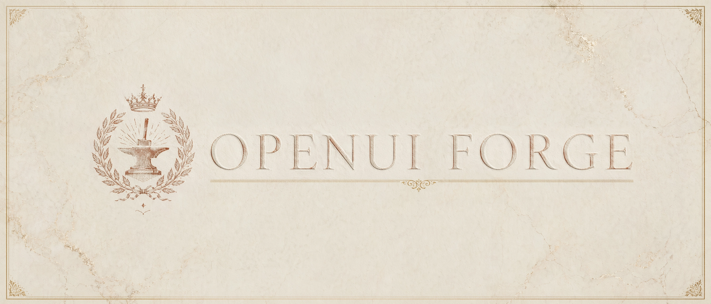

<div align="center">

</div>

# OpenUI Forge

The cross-IDE, multi-stack agent skill for [OpenUI](https://www.openui.com), the Open Standard for Generative UI. Drop OpenUI into any existing codebase, in any LLM provider, in any backend language.

[](https://github.com/OthmanAdi/openui-forge)
[](LICENSE)
[](https://skills.sh/OthmanAdi/openui-forge)
[](https://github.com/OthmanAdi/openui-forge/stargazers)
[](https://github.com/OthmanAdi/openui-forge/actions/workflows/skill-validation.yml)
[](https://spruce-prism-8yya.here.now/)
[](https://github.com/thesysdev/openui/blob/main/ADOPTERS.md)

> Listed in OpenUI's official [ADOPTERS.md](https://github.com/thesysdev/openui/blob/main/ADOPTERS.md) (the upstream list of projects using OpenUI; the file notes inclusion is not an endorsement by the maintainers).

---

## What this is

OpenUI is a streaming-first generative UI framework. Models output a compact line-oriented DSL ([OpenUI Lang](https://www.openui.com/docs/openui-lang/overview)) instead of JSON or HTML, up to 67% more token-efficient than JSON-based alternatives, with progressive rendering as tokens arrive and graceful handling of hallucinated components.

`openui-forge` is an agent skill that handles the parts the official OpenUI scaffolder doesn't:

- Adds OpenUI to **existing** projects (the canonical `npx @openuidev/cli create` is greenfield-only).
- Ships **non-JavaScript backend templates**: Python (FastAPI), Go (net/http), Rust (Axum), C# (ASP.NET Core), Java (Spring WebFlux), Ruby (Rails), PHP (Laravel), and Elixir (Phoenix).
- Wires up **any LLM provider directly**: OpenAI, Anthropic, LangChain, Vercel AI SDK, plus any OpenAI-compatible endpoint (Gemini, OpenRouter, xAI, DeepSeek, Groq, Mistral, Together, Fireworks, Ollama, LM Studio) via `OPENAI_BASE_URL` (see [Provider routing](#provider-routing-openai_base_url)).
- Mirrors skill content to additional agent platforms beyond Claude Code (Cursor, Gemini CLI, Codex, and more) using the `.agents/skills/` cross-tool standard.

It complements the official [`thesysdev/openui` skill](https://github.com/thesysdev/openui/tree/main/skills/openui), which targets a Next.js + OpenAI scaffold. Use this one when your stack does not match that default.

---

## Install

```bash
# Full skill (scaffolding, components, integration, validation, prompt generation)
npx skills add OthmanAdi/openui-forge --skill openui-forge -g

# Or a single stack-specific variant
npx skills add OthmanAdi/openui-forge --skill openui-forge-openai     -g
npx skills add OthmanAdi/openui-forge --skill openui-forge-anthropic  -g
npx skills add OthmanAdi/openui-forge --skill openui-forge-langchain  -g
npx skills add OthmanAdi/openui-forge --skill openui-forge-vercel     -g
npx skills add OthmanAdi/openui-forge --skill openui-forge-python     -g
npx skills add OthmanAdi/openui-forge --skill openui-forge-go         -g
npx skills add OthmanAdi/openui-forge --skill openui-forge-rust       -g

# Additional backend languages
npx skills add OthmanAdi/openui-forge --skill openui-forge-csharp     -g
npx skills add OthmanAdi/openui-forge --skill openui-forge-java       -g
npx skills add OthmanAdi/openui-forge --skill openui-forge-ruby       -g
npx skills add OthmanAdi/openui-forge --skill openui-forge-php        -g
npx skills add OthmanAdi/openui-forge --skill openui-forge-elixir     -g

# Chinese localization
npx skills add OthmanAdi/openui-forge --skill openui-forge-zh         -g
```

Or from npm, which carries all 27 bundled skills in one package ([openui-forge](https://www.npmjs.com/package/openui-forge)):

```bash
pi install npm:openui-forge
```

**Requirements:** Node.js >= 22 (24 LTS recommended). React peer `^18.3.1 || ^19.0.0` (`react-dom` peer `^18.0.0 || ^19.0.0`).

---

## Provider routing (`OPENAI_BASE_URL`)

Any OpenAI-compatible endpoint works by pointing the OpenAI client at a different base URL. Set `OPENAI_BASE_URL` (the exact env var; the old `OPENAI_API_BASE` was removed in `openai` v6) and `OPENAI_MODEL`, keep your provider's API key in the standard slot. Example model ids are current as of June 2026; check each provider's catalog for the live list.

| Provider | `OPENAI_BASE_URL` | Example model id |
|----------|-------------------|------------------|
| Gemini | `https://generativelanguage.googleapis.com/v1beta/openai/` | `gemini-2.5-flash` |
| OpenRouter | `https://openrouter.ai/api/v1` | `openai/gpt-5.5` |
| xAI (Grok) | `https://api.x.ai/v1` | `grok-4` |
| DeepSeek | `https://api.deepseek.com` | `deepseek-chat` |
| Groq | `https://api.groq.com/openai/v1` | `llama-3.3-70b-versatile` |
| Mistral | `https://api.mistral.ai/v1` | `mistral-large-latest` |
| Together | `https://api.together.ai/v1` | `meta-llama/Llama-3.3-70B-Instruct-Turbo` |
| Fireworks | `https://api.fireworks.ai/inference/v1` | `accounts/fireworks/models/llama-v3p1-70b-instruct` |
| Ollama (local) | `http://localhost:11434/v1/` | `llama3.2` (any placeholder API key) |
| LM Studio (local) | `http://localhost:1234/v1` | loaded model name (any placeholder API key) |

> **Azure OpenAI is not a generic drop-in.** Use `OPENAI_BASE_URL=https://YOUR-RESOURCE.openai.azure.com/openai/v1/`, set `OPENAI_MODEL` to your **deployment name** (not a catalog id), and use the `AzureOpenAI` client. The legacy path also needs `?api-version=`. Base-URL routing covers chat completions only, not full API parity.

---

## Commands

| Command | Description |
|---------|-------------|
| `/openui` | Smart detection. Analyzes the project state and recommends the next action. |
| `/openui:scaffold` | Add OpenUI to an existing project, or scaffold a new one via the official CLI. |
| `/openui:component` | Create a new component with Zod schema and React renderer. |
| `/openui:integrate` | Wire up the LLM backend for the detected stack. |
| `/openui:prompt` | Generate or regenerate the system prompt from the component library. |
| `/openui:validate` | 10-step validation pipeline (deps, library, prompt, route, page, CSS, adapter, CORS, etc.). |

---

## Supported stacks

| Stack | Language | LLM | Backend stream | Frontend `streamProtocol` |
|-------|----------|-----|----------------|---------------------------|
| OpenAI SDK | TypeScript | OpenAI (or any OpenAI-compatible via `OPENAI_BASE_URL`) | NDJSON via `response.toReadableStream()` | `openAIReadableStreamAdapter()` |
| Anthropic SDK | TypeScript | Anthropic Claude | SSE (Anthropic events converted) | `openAIAdapter()` |
| LangChain / LangGraph | TypeScript | Any (via LangChain) | SSE (LangChain chunks converted) | `openAIAdapter()` or `langGraphAdapter()` |
| Vercel AI SDK | TypeScript | Any (via AI SDK) | Native UIMessageStream | Native `processMessage` (no adapter) |
| Python (FastAPI) | Python | OpenAI / Anthropic | SSE | `openAIAdapter()` |
| Go (`net/http`) | Go | OpenAI-compatible HTTP | SSE passthrough | `openAIAdapter()` |
| Rust (Axum) | Rust | OpenAI-compatible HTTP | SSE via Axum `Sse<...>` | `openAIAdapter()` |
| C# (ASP.NET Core) | C# | OpenAI-compatible HTTP | SSE passthrough | `openAIAdapter()` |
| Java (Spring WebFlux) | Java | OpenAI-compatible HTTP | SSE | `openAIAdapter()` |
| Ruby (Rails) | Ruby | OpenAI-compatible HTTP | SSE passthrough | `openAIAdapter()` |
| PHP (Laravel) | PHP | OpenAI-compatible HTTP | SSE passthrough | `openAIAdapter()` |
| Elixir (Phoenix) | Elixir | OpenAI-compatible HTTP | SSE passthrough | `openAIAdapter()` |

> Adapter selection follows one rule: match the backend's response format. SSE (`data: {json}\n\n`) pairs with `openAIAdapter()`; NDJSON (one raw JSON per line) pairs with `openAIReadableStreamAdapter()`.

**Frontend runtimes:** all stacks above use the React binding, which is the most complete. OpenUI Lang also ships framework bindings for Vue 3 (`@openuidev/vue-lang`, peer `vue >= 3.5.0`) and Svelte 5 (`@openuidev/svelte-lang`, peer `svelte >= 5.0.0`), both built on the framework-agnostic `@openuidev/lang-core` substrate.

---

## Architecture

```
Component Library     System Prompt        LLM Backend
(Zod + React)    -->  (generated)     -->  (any provider, OPENAI_BASE_URL-routable)
                                                |
                                                | streams OpenUI Lang
                                                v
Live UI          <--  Parser           <--  streamProtocol Adapter
(React)               (@openuidev/             (openAIAdapter, openAIReadableStreamAdapter,
                       react-lang)              langGraphAdapter, openAIResponsesAdapter, ...)
```

Define components with Zod schemas + React renderers, assemble them into a library, generate a system prompt, the LLM streams OpenUI Lang, the adapter normalizes the byte stream into events, and the parser renders React components progressively.

**Upstream packages (verified against the npm registry):**

| Package | Purpose |
|---------|---------|
| `@openuidev/lang-core` | Framework-agnostic substrate: parser, validation, prompt generation |
| `@openuidev/react-lang` | React binding: `defineComponent`, `createLibrary`, `Renderer` |
| `@openuidev/react-headless` | State: `ChatProvider`, streaming adapters, message formats (Zustand) |
| `@openuidev/react-ui` | UI: `FullScreen` / `Copilot` / `BottomTray` layouts, 30+ built-in components, theming |
| `@openuidev/cli` | CLI: scaffold apps, generate system prompts |

---

## Supported agent platforms

`.agents/skills/` is the cross-tool standard directory, and it is the canonical source of truth. `scripts/sync-platforms.{sh,ps1}` mirrors that content to each tool's own directory so the same skill is available across:

Claude Code, Cursor, Gemini CLI, Kiro, Codex CLI, CodeBuddy, Continue, Factory, OpenCode, Pi, Mastra.

> Note: not every tool reads a `skills/` folder. Kiro uses `.kiro/steering/` and Continue uses `.continue/rules/`, so the sync adapts the content into each tool's actual convention rather than assuming a uniform `skills/` path.

---

## Links

- [OpenUI documentation](https://www.openui.com/docs)
- [OpenUI on GitHub](https://github.com/thesysdev/openui)
- [OpenUI Discord](https://discord.com/invite/Pbv5PsqUSv)
- [LLM-readable docs (for AI agents)](https://www.openui.com/llms.txt) ([full corpus](https://www.openui.com/llms-full.txt))
- [skills.sh listing](https://skills.sh/OthmanAdi/openui-forge)
- [Author portfolio](https://othmanadi.com)

---

Made by [OthmanAdi](https://github.com/OthmanAdi)
